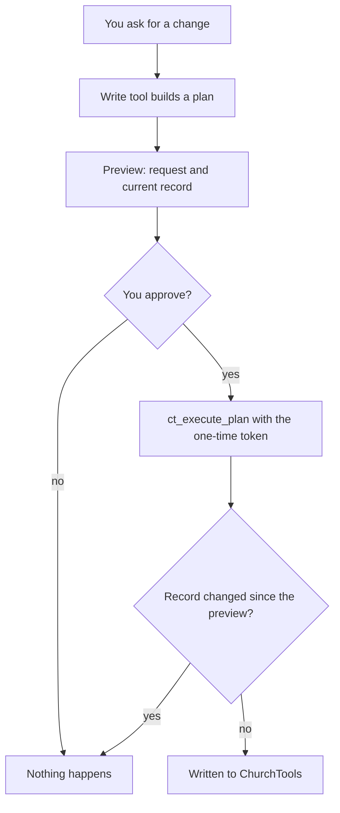

<div align="center">

# churchtools-mcp

**Talk to your ChurchTools instance from Claude, and approve every change before it happens.**

[](https://github.com/NoahDR/churchtools-mcp/actions/workflows/ci.yml)
[](LICENSE)


</div>

An [MCP](https://modelcontextprotocol.io) server for [ChurchTools](https://church.tools). Plug it into Claude
Code or any other MCP client and ask in plain words:

> _Who is on the tech team for Sunday's service, and who is still missing?_
>
> _Put Lena into the youth leaders group._
>
> _Move the prayer evening on 12 November to 8 pm._

Reads happen right away. Writes come back as a preview first: what would change, next to the record as it
is now. Nothing is written until you say yes.

> [!NOTE]
> A community project, not made, endorsed or supported by ChurchTools Innovations GmbH.

## What it can do

- **Persons**: search, read, create, update, delete. The preview of a create lists persons with the same name.
- **Groups**: manage groups and their members, roles included.
- **Calendars**: list, create, update and delete appointments. Creating one from an event template creates
  the event too.
- **Events**: read events and services, and staff them with people from ChurchTools or by name.
- **Everything else**: the server reads your instance's own OpenAPI spec, so Claude can find and call any of
  the 800+ endpoints, such as finance, songs, wiki or resources.

## Quick start

You need Node 26 and a ChurchTools account (with 2FA, ideally).

```bash
git clone https://github.com/NoahDR/churchtools-mcp.git
cd churchtools-mcp
npm ci && npm run build
cp .env.example .env
```

Fill in `.env`, keeping the double quotes: a `#` in an unquoted value starts a comment.

```bash
CT_URL="https://your-church.church.tools"
CT_USERNAME="you@example.org"
CT_PASSWORD="..."
```

Then register the server:

| Client                       | How                                                                                           |
| ---------------------------- | --------------------------------------------------------------------------------------------- |
| Claude Code, this repository | start `claude` in the repository and approve `churchtools` from `.mcp.json` once              |
| Claude Code, everywhere      | `claude mcp add --scope user churchtools -- node --env-file=<repo>/.env <repo>/dist/index.js` |
| Any other MCP client         | run `node --env-file=<repo>/.env <repo>/dist/index.js` over stdio                             |

Ask Claude to log in. With 2FA on, it asks for the current code from your authenticator app. A session
lasts about a day.

## How a write works



A plan token works once and expires after 10 minutes. A generic write to a path without a GET endpoint
skips the "changed since" check, because there is nothing to compare.

## Security

- **Your rights, no more.** The server acts as the logged-in user. Give that account only the rights you
  need.
- **Secrets stay local.** The password goes only to `CT_URL` over https, and the server follows no
  redirects. The session lives in memory. On disk there is only the cached API spec in
  `~/.cache/churchtools-mcp`.
- **Data protection.** Member data you ask about goes to your MCP client's model provider. Check that this
  fits your church's rules before you use real data.
- **Prompt injection.** Text inside ChurchTools records reaches the model and could try to steer it. That is
  why every write needs your approval: read the preview.

Found a vulnerability? Please report it privately: [SECURITY.md](SECURITY.md).

<details>
<summary><b>All tools</b></summary>

| Group        | Tools                                                                                                                                                                                           |
| ------------ | ----------------------------------------------------------------------------------------------------------------------------------------------------------------------------------------------- |
| Session      | `ct_status`, `ct_login`                                                                                                                                                                         |
| Plans        | `ct_execute_plan`                                                                                                                                                                               |
| Any endpoint | `ct_search_api`, `ct_get_operation`, `ct_api_request`                                                                                                                                           |
| Persons      | `ct_search_persons`, `ct_get_person`, `ct_create_person`, `ct_update_person`, `ct_delete_person`                                                                                                |
| Groups       | `ct_search_groups`, `ct_get_group`, `ct_create_group`, `ct_update_group`, `ct_delete_group`, `ct_list_group_members`, `ct_add_group_member`, `ct_update_group_member`, `ct_remove_group_member` |
| Calendars    | `ct_list_calendars`, `ct_list_appointments`, `ct_get_appointment`, `ct_create_appointment`, `ct_update_appointment`, `ct_delete_appointment`                                                    |
| Events       | `ct_list_events`, `ct_get_event`, `ct_list_services`, `ct_update_event`, `ct_delete_event`, `ct_assign_event_service`, `ct_set_external_event_service`                                          |

</details>

<details>
<summary><b>Not included (yet)</b></summary>

- HTTP transport, several instances, an npm package: it runs locally over stdio against one instance.
- Bulk writes and an audit log: one record per write, and ChurchTools keeps its own history.
- OAuth and long-lived login tokens: the login is password plus 2FA code, per session.
- A tool that creates only an event: `ct_create_appointment` does it through an event template
  ([docs/churchtools-api.md](docs/churchtools-api.md)).
- Splitting appointment series, editing a single occurrence, event service counts, 2FA enrolment,
  anonymising personal data.

</details>

## Contributing

Issues and pull requests are welcome: start with [CONTRIBUTING.md](CONTRIBUTING.md). `npm run check`
(types, lint, format, build, 1,000+ tests) must pass, and CI runs it on every pull request. Please follow
the [Code of Conduct](CODE_OF_CONDUCT.md).

## Uninstall

Remove `churchtools` from your MCP client, then delete `.env` and `~/.cache/churchtools-mcp`. In ChurchTools
nothing stays behind besides the ended session.

## License

[MIT](LICENSE) © Noah Reinbold
